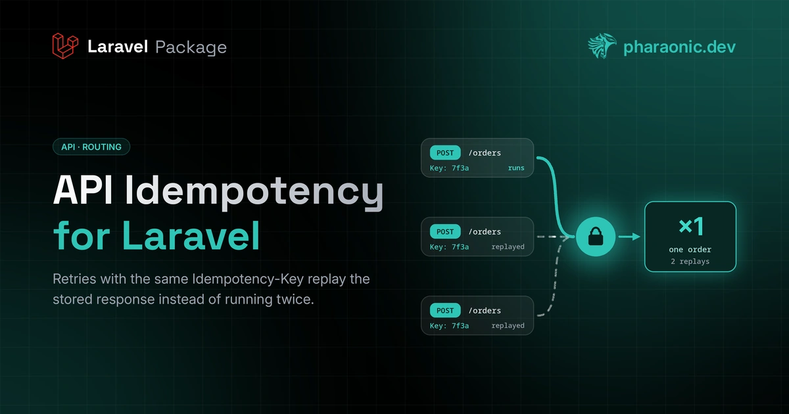

<p align="center"><a href="https://pharaonic.dev/packages/laravel/api-idempotency" target="_blank"></a></p>

<p align="center">
  <a href="https://php.net" target="_blank"></a>
  <a href="https://laravel.com" target="_blank"></a>
  
  
  <br>
  <a href="https://packagist.org/packages/Pharaonic/laravel-api-idempotency" target="_blank"></a>
  <a href="https://packagist.org/packages/pharaonic/laravel-api-idempotency" target="_blank"></a>
  <a href="https://packagist.org/packages/pharaonic/laravel-api-idempotency" target="_blank"></a>
</p>

<h3 align="center">Opt-in Idempotency-Key handling for Laravel routes: retries replay the stored response instead of running twice.</h3>
<br>

## Installation

```bash
composer require pharaonic/laravel-api-idempotency
```

The service provider is registered automatically. The default `database` store needs its table; publish the migration and run it (skip this when you only use Redis):

```bash
php artisan vendor:publish --tag=api-idempotency-migrations
php artisan migrate
```

Publish the configuration when you need to change it:

```bash
php artisan vendor:publish --tag=api-idempotency-config
```

## Usage

```php
use Illuminate\Support\Facades\Route;

Route::middleware('auth:api')->group(function () {
    Route::post('orders', 'OrderController@store')->idempotent();

    Route::post('payments', 'PaymentController@store')->idempotent(ttl: 604800);
});
```

Clients send an `Idempotency-Key` header. A retry with the same key and request gets the stored response with `Idempotency-Replayed: true`; the same key with another request, or while the first one still runs, gets `409`. This prevents duplicate execution of one key; it is not exactly-once delivery of external side effects.

## Documentation

Full documentation: [Laravel API Idempotency Documentation](https://pharaonic.dev/packages/laravel/api-idempotency).

## Support & Security

See [SUPPORT.md](SUPPORT.md) and [SECURITY.md](SECURITY.md). Contributions are welcome; see [CONTRIBUTING.md](CONTRIBUTING.md).

## License

MIT. See [LICENSE](LICENSE).
